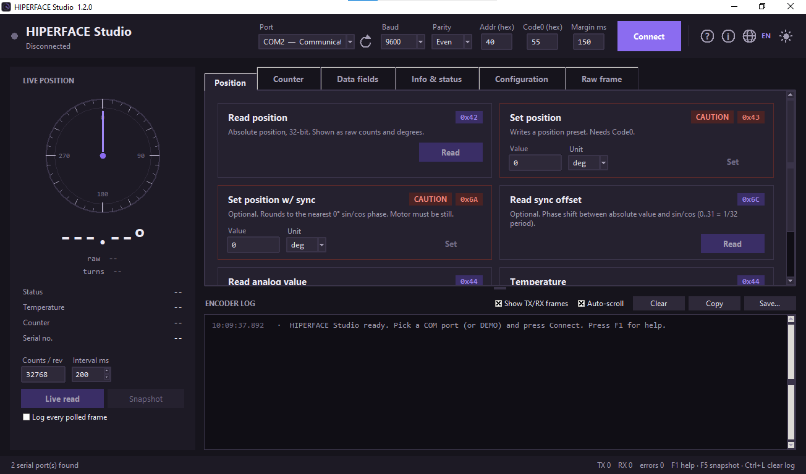
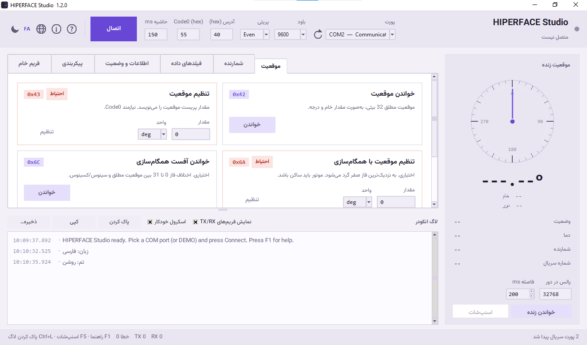

<div align="center">

# HIPERFACE® Studio

**A bilingual desktop terminal for SICK HIPERFACE® motor-feedback encoders over RS-485**

Spec-accurate command cards · live position dashboard · byte-level TX/RX log · built-in encoder simulator

[](CHANGELOG_FA.md)


[](README_FA.md)



**Figure 1 — Dark theme, English (LTR) UI:** connection toolbar, live position dial, command cards for the
Position tab, and the colour-coded encoder log.

</div>

---

HIPERFACE Studio is a standalone Windows application for commissioning, inspecting and troubleshooting
SICK HIPERFACE® encoders on an RS-485 link. It implements the command set of the
*Operating Instructions — Specification HIPERFACE® Motor Feedback Protocol* (IM0064865 / 8010701) as a
card-based GUI, so every protocol command can be issued, decoded and logged without writing a script.

No hardware is required to try it: the built-in **DEMO** port simulates an SRM50-style encoder, including
error frames, access codes, data fields, the warning bit, address changes and UART reconfiguration.

> **Persian version:** [README_FA.md](README_FA.md) · **Changelog (1.2.0):** [CHANGELOG_FA.md](CHANGELOG_FA.md)

## Contents

- [Screenshots](#screenshots)
- [Key features](#key-features)
- [Getting started](#getting-started)
- [Connecting to an encoder](#connecting-to-an-encoder)
- [Protocol reference](#protocol-reference)
- [Command reference](#command-reference)
- [User interface](#user-interface)
- [Building the Windows executable](#building-the-windows-executable)
- [Specification document](#specification-document)
- [Keyboard shortcuts](#keyboard-shortcuts)
- [Troubleshooting](#troubleshooting)
- [Project structure](#project-structure)
- [Requirements](#requirements)
- [License and disclaimer](#license-and-disclaimer)

---

## Screenshots

The application ships with two complete visual themes and two fully translated interfaces. Language, theme
and connection settings are persisted between sessions, and switching language or theme never drops an
open connection or clears the log.

| | Dark theme · English | Light theme · فارسی |
|---|---|---|
| Layout | Left-to-right | Full right-to-left, mirrored panels |
| Font | System UI | [Vazirmatn](https://github.com/rastikerdar/vazirmatn), loaded privately (no install, no admin rights) |
| Screenshot | **Figure 1**, above | **Figure 2**, below |

### Light theme · Persian (RTL)



**Figure 2 — Light theme, Persian (RTL) UI:** the toolbar, tabs, cards and log are mirrored, with full
Vazirmatn typography and translated command descriptions.

---

## Key features

**Complete command coverage.** 22 protocol opcodes plus composite helpers, organised into six tabs —
*Position*, *Counter*, *Data fields*, *Info & status*, *Configuration* and *Raw frame*. Each command has
its own card with inputs, the opcode badge, a plain-language description and a decoded result.

**Live position dashboard.** A dial, degrees, the raw 32-bit value and the turn counter update after every
position read. Configurable counts/revolution and polling interval, continuous *Live read*, and a
*Snapshot* (F5) that reads position, status and temperature in one pass.

**Byte-level TX/RX log.** TX frames in blue, RX frames in green, with the XOR checksum as the last byte.
Decoded results (`✓`), errors (`✗`), warnings (`!`) and command starts (`▸`) are annotated inline.
Auto-scroll, clear, copy to clipboard and save to `.txt`.

**Spec-accurate timing.** The master waits the maximum slave response time from Table 10 of the
specification (5–250 ms, per command) plus transfer time and the mandatory inter-frame pause of
`55 / baud` (5.73 ms at 9600 Bd). An adjustable *Margin ms* compensates for slow USB adapters.

**Correct error and warning handling.** Replies with bit 7 set (`Command + 80h`) are accepted as valid and
flagged as warnings; `50h` error frames and the `D0h` error-plus-warning case are decoded from the fault
code table (00h–24h). *Read all codes* drains the four-entry error stack and clears the warning bit.

**Safe state changes.** Every command that writes persistent encoder data carries a red **CAUTION** badge
and asks for confirmation first. After `57h` / `67h` / `53h` the PC port is reconfigured automatically to
the new baud rate and parity, so the link is not lost.

**Raw frame builder.** Type address, command and data in hex; the XOR checksum is appended and previewed
before sending. `Read bytes = 0` reads until the frame ends. `FF` address is supported for broadcasts.

**Built-in help (F1).** A searchable-by-TOC help window with frame structure, field-status bit layout,
the full fault-code table, troubleshooting, shortcuts and clickable links to the specification PDF.
The *About* dialog reports version, developer, repository, PDF/font status and Python/Tk/pyserial info
with a one-click *Copy info*.

**Zero heavy dependencies.** Pure Python 3.8 + Tkinter + pyserial. No Qt, no web view, no installer,
no registry writes. Python 3.8.10 64-bit builds still run on Windows 7 SP1.

---

## Getting started

### Option A — Run from source

```bash
git clone https://github.com/morteza-taheri/HiperfaceStudio.git
cd HiperfaceStudio
pip install -r requirements.txt
python hiperface_studio.py
```

On Windows, double-click [`run_from_source.bat`](run_from_source.bat) instead — it installs `pyserial`
if needed and launches the GUI without a console window.

### Option B — Build a portable EXE

Double-click [`build_exe.bat`](build_exe.bat). It creates a virtual environment, installs the pinned
dependencies, bundles the icon, fonts and (optionally) the specification PDF, and produces
`HiperfaceStudio.exe`. See [Building the Windows executable](#building-the-windows-executable).

### Option C — No encoder at hand

Select **`DEMO (simulated)`** in the *Port* dropdown and press **Connect**. The simulator behaves like an
SRM50 and supports access codes, injected errors, warning bits, data fields, address changes and UART
settings — enough to explore every command card safely.

---

## Connecting to an encoder

1. Connect a USB–RS485 adapter to the encoder data lines (`A/-`, `B/+`) and power the encoder (7–12 V).
2. Select the COM port in the toolbar; use the refresh icon if the adapter was plugged in afterwards.
3. Keep the factory defaults unless the encoder was reconfigured, then press **Connect**. A green dot
   confirms the port is open.
4. Go to *Info & status* → **Read everything** to verify the link in a single click.

| Setting | Factory default | Notes |
|---|---|---|
| Port | — | USB–RS485 adapter, or `DEMO (simulated)` |
| Baud | `9600` | 600 / 1200 / 2400 / 4800 / 9600 / 19200 / 38400 supported (`E4h` = 9600, even, 5× timeout) |
| Parity | `Even` | 8 data bits, 1 stop bit (8E1) |
| Addr (hex) | `40` | Valid `40`–`5F`; `FF` = broadcast, use with a single encoder only |
| Code0 (hex) | `55` | Access code for `43h`, `49h`, `55h`, `57h`, `6Ah`, `6Bh` |
| Margin ms | `150` | Extra wait on top of the spec timing |

**Wiring:** use a 130 Ω termination with 1 kΩ bias resistors. If nothing answers, try swapping A/B.

---

## Protocol reference

```
Master  ->  [Address][Command][Data 0 .. n][Checksum]
Slave   ->  [Address][Command][Data 0 .. m][Checksum]
Error   ->  [Address][50h][Error code][Checksum]
Warning ->  [Address][Command + 80h][Data ...][Checksum]

Checksum = XOR of all preceding bytes, including the address.
Example: 40 42 -> 02
```

- **UART:** 1 start bit, 8 data bits (LSB first), parity, 1 stop bit. A frame ends after a silence longer
  than `55 / baud`; the application keeps this gap between frames.
- **Warning bit:** the command succeeded, but the encoder holds a stored warning. Read it with `50h`
  (*Read all codes*) to clear the bit.
- **Power-on / reset:** the encoder starts after 100–200 ms, uses factory settings until ~900 ms and
  switches to stored settings after ~1100 ms. The app waits accordingly after `53h`.
- **Data fields:** user memory is divided into fields of 16–128 bytes (multiples of 16). The status byte
  encodes size (bits 0–2), code-on (bit 3), code number (bits 4–5), writable (bit 6) and exists (bit 7).
  Only the last field can be resized or deleted; field `FF` is the read-only extended type label.
- **Counts/revolution:** sin/cos periods × 32 — SRx50: 32768, SKx36: 4096, SEx34/37/52: 512.

---

## Command reference

Commands marked ⚠️ change persistent encoder state and require an explicit confirmation in the UI.

| Code | Command | Tab | Notes |
|---|---|---|---|
| `42h` | Read position | Position | 32-bit absolute value, shown as raw counts and degrees |
| `43h` | Set position ⚠️ | Position | Writes a position preset; needs Code0 |
| `6Ah` | Set position with sync ⚠️ | Position | Optional; rounds to the nearest 0° sin/cos phase, motor must be still |
| `6Ch` | Read sync offset | Position | Optional; phase shift 0–31 = 1/32 period |
| `44h` | Read analog value / temperature | Position | Channel `48h` = internal temperature, signed °C |
| `46h` | Read counter | Counter | 24-bit non-volatile counter |
| `47h` | Increment counter | Counter | Adds 1 and reads the new value back |
| `49h` | Reset counter ⚠️ | Counter | Clears to zero; needs Code0 |
| `4Ah` | Read data | Data fields | 1–128 bytes; field `FF` = extended type label (64 bytes) |
| `4Bh` | Store data ⚠️ | Data fields | 1–128 hex bytes, echo verification, writable fields only |
| `4Ch` | Data field status | Data fields | Size, linked code, code-on, writable, exists |
| `4Dh` | Create / modify / delete field ⚠️ | Data fields | 16–128 bytes in 16-byte steps; `4Dh` with bit 7 = 0 deletes |
| `4Eh` | Memory status | Data fields | Free memory (16-byte blocks) and field count |
| `4Fh` | Set access code ⚠️ | Data fields | One of four codes; **there is no factory restore — write it down** |
| `50h` | Encoder status | Info & status | Pops one code from the 4-entry error stack; clears the warning bit |
| `52h` | Type label | Info & status | UART settings, type code, memory size, option code |
| `56h` | Serial number & version | Info & status | 9 + 20 + 8 ASCII bytes |
| `53h` | Encoder reset ⚠️ | Configuration | Software reset; the encoder sends no reply |
| `55h` | Set encoder address ⚠️ | Configuration | `40h`–`5Fh`; the reply already uses the new address |
| `57h` | Set serial interface ⚠️ | Configuration | Permanent; active after `53h` or a power cycle |
| `67h` | Temporarily set serial interface ⚠️ | Configuration | Optional; reply uses old settings, lost on reset |
| `6Bh` | Sensor adjustment ⚠️ | Configuration | Optional, implementation-specific — check the datasheet |
| — | UART settings byte builder | Configuration | Composes the settings byte for `57h` / `67h` (default `E4h`) |
| — | Send raw frame | Raw frame | Any frame in hex, XOR checksum appended automatically |

*Read everything* (Info & status) is a composite helper: status, type label, serial/version, memory,
counter, temperature and position in one run.

`50h` fault codes cover `00h No error` through `24h Multiturn counter error`, including `0Bh Unknown
command`, `0Fh Wrong access code`, `1Eh Encoder temperature critical` and `1Fh Speed too high`. The full
table is available in the in-app Help (F1).

---

## User interface

| Area | What it does |
|---|---|
| Toolbar | Port, baud, parity, address, Code0, margin, Connect, Help, About, language, theme |
| Live position | Dial, degrees, raw value, turns, status, temperature, counter, serial number, counts/rev, interval, Live read, Snapshot |
| Command tabs | Six tabs of self-contained cards; numbers accept decimal (`72`), `0x48` or `48h` |
| Encoder log | Colour-coded TX/RX frames, decoded results, show raw frames, auto-scroll, clear, copy, save |
| Raw frame | Free-form hex frame builder with live checksum preview |
| Help / About | Full protocol documentation, fault codes, PDF links, system information |

Language (EN/FA), theme (dark/light) and connection settings are saved to
`%APPDATA%\HiperfaceStudio\settings.json`.

---

## Building the Windows executable

1. Install **Python 3.8.10 64-bit** — the last release supporting Windows 7 — and tick
   *Add Python 3.8 to PATH* ([download](https://www.python.org/downloads/release/python-3810/)).
2. Optionally place the specification PDF (`*im0064865*.pdf`) in the project root.
3. Run `build_exe.bat`. Output: `HiperfaceStudio.exe` (single file, windowed, ~10 MB).

The script pins `pyinstaller==5.13.2` on Python 3.8 and falls back to the current PyInstaller on newer
interpreters — those builds work on Windows 10/11 but **not** on Windows 7. Fonts in `fonts/` and the
PDF, when present, are embedded automatically.

**Windows 7 notes:** SP1 is required. For `api-ms-win-crt-runtime-l1-1-0.dll` install KB2999226; for
`SetDefaultDllDirectories` install KB2533623.

> Built executables are intentionally not committed to this repository. Build locally with the script,
> or download a published binary from [Releases](https://github.com/morteza-taheri/HiperfaceStudio/releases).

---

## Specification document

Protocol behaviour follows SICK's *Operating Instructions — Specification HIPERFACE® Motor Feedback
Protocol* (**IM0064865 / 8010701**, revision 2021-12-15). The PDF is **not redistributed** in this
repository; obtain it from the publisher:

🔗 [Official specification PDF on sick.com](https://www.sick.com/media/docs/5/65/865/operating_instructions_specification_hiperface%C2%AE_motor_feedback_protocol_en_im0064865.pdf)

The application looks for the PDF in this order: a file chosen manually in Help → a configured local
folder → next to the EXE → the working directory → a copy embedded in the EXE → the online version above.
Any PDF whose name contains `im0064865` is accepted. Without a local copy, Help falls back to the online
document.

---

## Keyboard shortcuts

| Key | Action |
|---|---|
| `F1` | Open Help |
| `F5` | Snapshot (position + status + temperature) |
| `Ctrl+L` | Clear log |
| `Ctrl+S` | Save log to a text file |
| `Esc` | Close Help / About |

---

## Troubleshooting

| Symptom | What to check |
|---|---|
| Timeout, no response | A/B wiring (try swapping), 130 Ω termination with 1 kΩ bias, encoder power, address, baud, parity; raise *Margin ms* |
| Checksum mismatch | Noise or wrong parity — check grounding, cable shield and parity setting |
| Port busy / Windows error 31 | Another tool holds the port; close it, replug the adapter or re-enable it in Device Manager |
| Error `0Fh` | Wrong access code — Code0 or the field's linked code does not match |
| Error `0Bh` | Unknown/optional command — the encoder does not implement `6Ah`, `6Bh`, `67h` or `6Ch` |
| Persian text falls back | Put `Vazirmatn-Regular.ttf` and `Vazirmatn-Bold.ttf` in `fonts/` (or run `get_vazir_font.bat`) |

---

## Project structure

| Path | Purpose |
|---|---|
| `hiperface_studio.py` | GUI: toolbar, dashboard, command cards, log, Help and About |
| `hiperface_core.py` | Protocol layer, frame encoding/decoding, timing, fault codes, DEMO simulator, worker thread |
| `hiperface_i18n.py` | English/Persian strings, card descriptions, RTL/bidi helpers |
| `hiperface_help.py` | In-app Help content (both languages) |
| `app.ico` | Application icon |
| `fonts/` | Vazirmatn Regular/Bold (SIL Open Font License) |
| `get_vazir_font.bat` | Downloads the Vazirmatn fonts into `fonts/` |
| `run_from_source.bat` | Launches the GUI directly, without a console |
| `build_exe.bat` | One-click PyInstaller build |
| `HiperfaceStudio.spec` | PyInstaller specification |
| `requirements.txt` | Runtime dependency (`pyserial==3.5`) |
| `MainScreen.png`, `MainScreenFa.png` | Screenshots used in this document |
| `README_FA.md`, `CHANGELOG_FA.md` | Persian documentation and 1.2.0 changelog |

---

## Requirements

| | |
|---|---|
| Runtime | Python 3.8+ (3.8.10 64-bit for Windows 7 targets), Tkinter (bundled with CPython on Windows) |
| Dependency | [`pyserial==3.5`](https://pypi.org/project/pyserial/) |
| Build only | `pyinstaller==5.13.2` on Python 3.8 |
| OS | Windows 7 SP1, Windows 10, Windows 11 (64-bit) |
| Hardware | USB–RS485 adapter, HIPERFACE® encoder, 7–12 V supply, 130 Ω termination |

---

## Documentation

- [English README](README.md) · [راهنمای فارسی](README_FA.md)
- [Changelog 1.2.0](CHANGELOG_FA.md)
- In-app Help (`F1`) — frame structure, command descriptions, fault codes, troubleshooting
- [Official SICK specification (IM0064865)](https://www.sick.com/media/docs/5/65/865/operating_instructions_specification_hiperface%C2%AE_motor_feedback_protocol_en_im0064865.pdf)
- [Issue tracker](https://github.com/morteza-taheri/HiperfaceStudio/issues)

---

## License and disclaimer

No license has been published for this repository yet — please contact the author before reusing or
redistributing the source. The bundled [Vazirmatn](https://github.com/rastikerdar/vazirmatn) fonts are
distributed under the SIL Open Font License; see `fonts/README.txt`.

**HIPERFACE® is a registered trademark of SICK AG.** This is an independent, unofficial tool and is not
affiliated with, endorsed by or supported by SICK AG. The official specification document is not included
in this repository. Commands marked **CAUTION** modify persistent encoder state — always back up your
configuration and read the encoder datasheet before using them.

---

**Author:** Morteza Taheri · <morteza.taheri@live.com> ·
[github.com/morteza-taheri/HiperfaceStudio](https://github.com/morteza-taheri/HiperfaceStudio)
